### Census: What does the network look like?

Census of the publicly reachable (listening) Bitcoin nodes across IPv4, IPv6, onion, and I2P. Every
count here is listening nodes only. The NAT'd non-listening majority accepts no inbound and is
invisible to any crawler, including this one. Counts are distinct nodes by IP.

---

### The reachable network

We handshaked every reachable listening node ourselves, on all four networks.

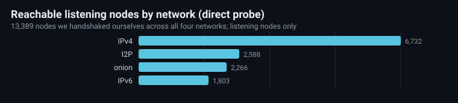

That is 13,389 nodes: 6,732 IPv4, 1,803 IPv6, 2,266 onion and 2,588 I2P. The clearnet side came from
73,345 unique addresses aggregated from five sources (addrman, KIT, achownodes, fishfoo, Bitnodes),
of which 11.6% answered; the rest were stale. Onion (11,586 addresses via 4 Tor SOCKS5 instances) and
I2P (5,967 via i2pd) were probed separately.

These counts are lower bounds. We reach what we target, so no mix here is the network's true
composition. A continuous crawler like Bitnodes samples differently and sees far less IPv6. We count
distinct IPs throughout: 57 hosts also listen on a second port (8,592 endpoints), but that is 8,535
distinct clearnet nodes. One record that completed a handshake, the reserved-space address
1111:1111::1, is excluded as a non-routable (poisoned) address, so reachable counts require a
globally-routable address.

Bitcoin Core is almost the whole network; btcd is the largest alternative.

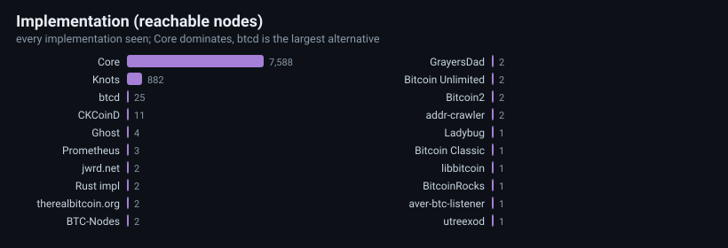

By AS type, most reachable nodes sit in hosting, not on residential lines.

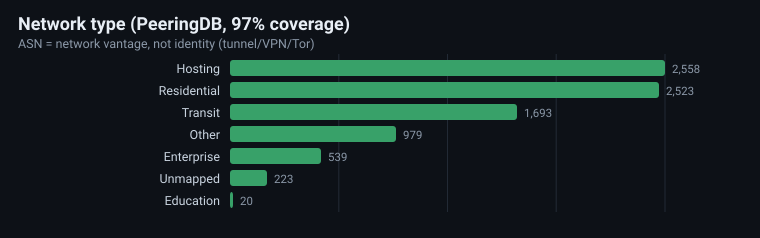

Each clearnet breakdown accounts for all 8,535 nodes. Implementation and AS type sum to 8,535 (the
AS-type chart includes 223 nodes with no PeeringDB entry). The version bands cover 8,470 nodes, with
65 more that sent no parseable version string. The country charts place 8,531 nodes, with 4 that no
geolocation source could resolve. `src/verify_numbers.py` recomputes all of these from the raw data
and fails if any figure or number drifts.

The directly-probed onion population is barely pruned (7% vs 23% clearnet), almost never below v25
(0.4% vs 5%), and has higher P2P_V2 adoption (95% vs 80%). The Knots share is about the same (12% vs 10%).

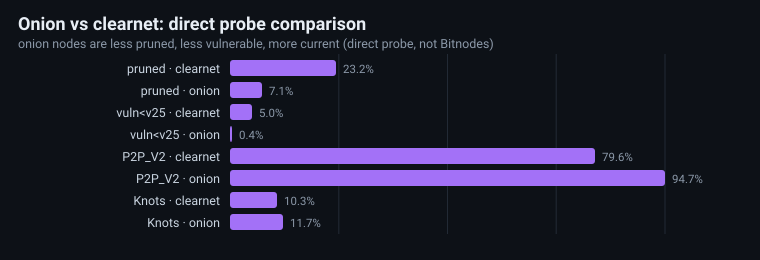

Across networks, pruned and vulnerable shares split the same way: IPv6 is the most pruned and most
exposed cohort, onion and I2P the least. (Rates from the Bitnodes cross-network snapshot.)

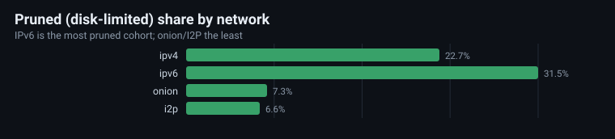
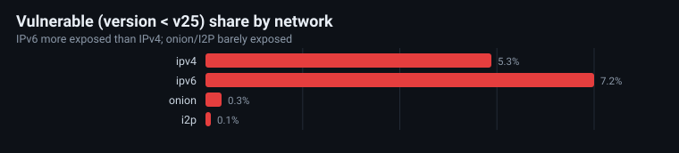

---

The analyses below are on the clearnet nodes: onion and I2P addresses are not geolocatable and their
latency is not comparable to clearnet.

### Geographic concentration: 95 countries, 59% in two

The US (3,433) and Germany (1,614) alone account for 59% of reachable clearnet nodes. 95 countries
host at least one; 51 of 54 African countries have zero. Africa has 13 nodes total (0.2%): South
Africa (10), Seychelles (2) and Angola (1). The next three countries are France (686), Canada (227)
and the UK (224).

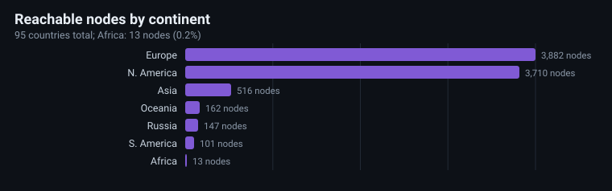
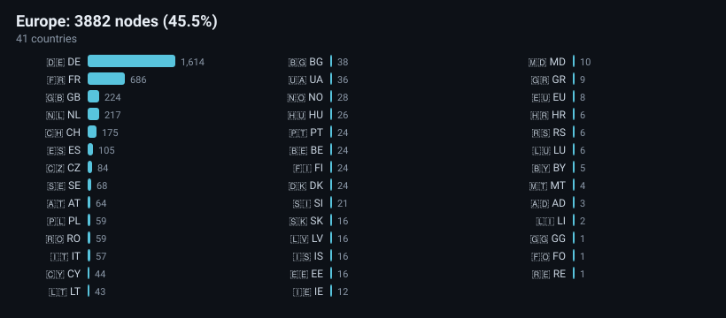
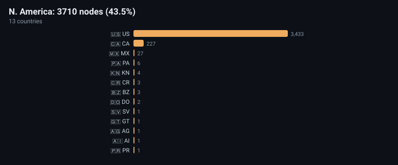
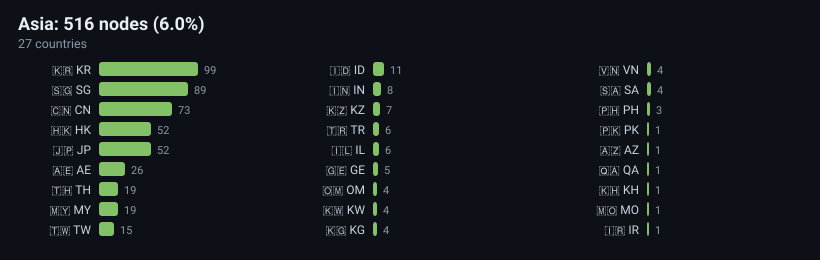
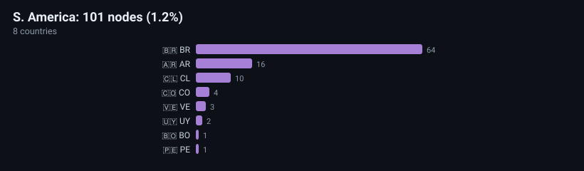

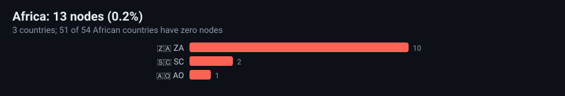

### AS concentration (raw data, open question)

The census records each reachable node's autonomous system (via Core's embedded asmap). Two raw
observations, stated as measurements only:

- Netgroup spread: large cloud and ISP networks each span many /16 ranges (the biggest a few
  hundred each), while no single AS holds more than 4.4% of the address-manager entries. asmap maps
  a whole AS to one network group; /16 bucketing would treat those ranges as separate groups.
- Capacity concentration: weighting each node by its measured block-serving throughput, the single
  largest AS hosts about 10% of reachable nodes but serves roughly 31% of the observed block
  bandwidth; the top ten ASes hold about 39% of nodes. Hosting networks serve blocks about 3.2x
  faster than residential.

We do not interpret these. Whether this concentration matters for eclipse or partition resistance,
and how asmap's netgroup collapse changes that, depends on attack models (Heilman et al. eclipse,
Tran et al. partitioning) that we do not evaluate. We leave it as an open question.

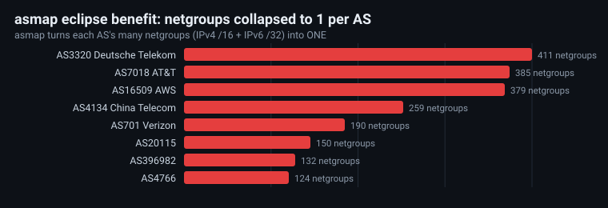
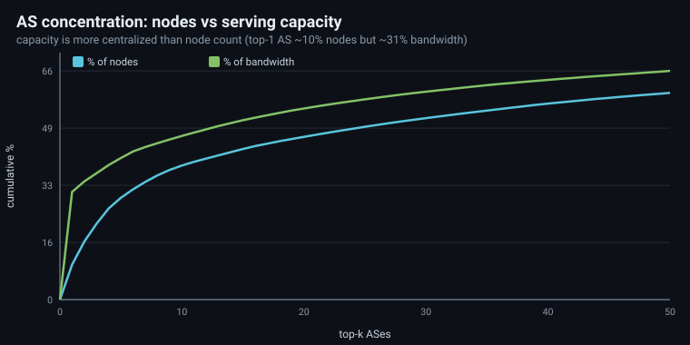
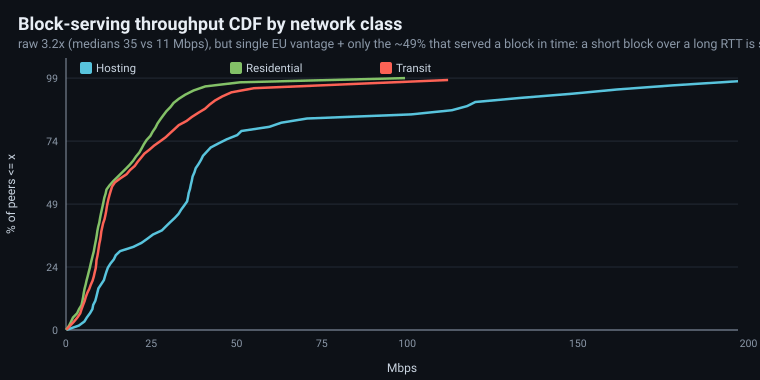

---

[Back to main report](../REPORT.md)
