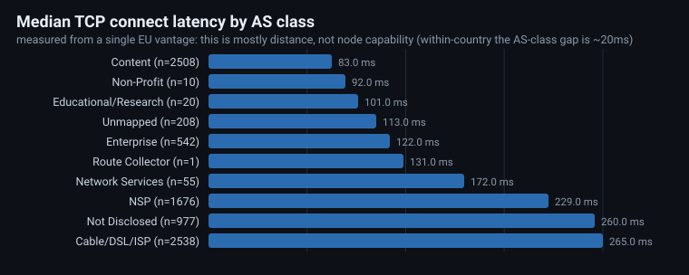
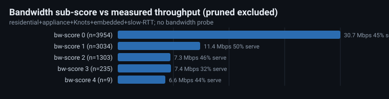
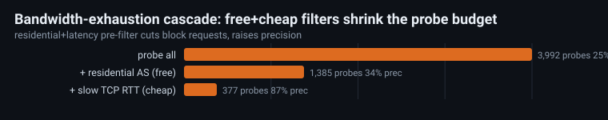

### Targeting: How cheaply can an adversary find weak nodes?

Latency profiles, bandwidth/disk scoring, and cascade filters that cut probe budgets by 91%.

---

### Peer latency, and two kinds of constrained node

To pressure the weakest nodes, how well does cheap passive metadata find them? Latency is the
cheapest: every handshake records `connect_ms` (TCP round-trip) at full coverage, and the prober
also times a ping/pong round trip (Core's min-ping). Broken down per dimension, latency tracks the
hosting/residential divide: datacenter (PeeringDB "Content") nodes answer in 83 ms and serve 35
Mbps, residential (Cable/DSL/ISP) 265 ms and 11 Mbps; by OS, Linux 168 ms vs the device class 256 ms.
Latency and throughput are the same axis seen twice: binned, they fall on a monotone curve. Latency
is a full-coverage proxy for the bandwidth a block probe measures expensively.

Profiling per dimension before merging caught one signal pointing the other way: pruned nodes are
faster (170 ms / 17 Mbps vs 207 ms / 14 Mbps overall), because operators prune to save disk on
cheap, well-connected VPS hosts, not constrained home machines. Pruning is a disk constraint,
orthogonal to the bandwidth constraint the other signals capture. We score two axes: a bandwidth
axis (residential AS, appliance user agent, Knots, embedded OS, slow latency) and a disk axis (the
pruned flag).

### Targeting the bandwidth axis

With pruned dropped, the bandwidth sub-score predicts throughput sharply: ranking by it alone, no
block probing, gives a 4.6-fold spread across bandwidth scores. As a targeting rule, a score of one
or more catches 89% of the bottom-quartile-slow nodes at 41% precision; two or more reaches 64%
precision (44% recall).

A naive adversary block-downloads from every node that will
serve a block (3,992, about half of reachable) to find the slow quarter. An adversary that filters
the free signals first does less work. Residential AS
(offline from the IP) then slow TCP latency (one handshake, no download) cut the probe budget 91%,
from 3,992 to 377. Latency as the second filter raises precision; the block probe confirms.

The disk axis needs no probe: the pruned flag is self-declared in the handshake, so the 1,981
limited-disk nodes (the natural target of a historic-block or disk-pressure attack) are enumerable
for free.

The strongest leaks on both axes cannot be removed. The pruned flag is protocol-mandatory: a pruned
node must advertise `NETWORK_LIMITED` so peers do not ask it for old blocks. The residential AS
and its latency are the node's location. Removable signals (appliance string, Knots banner)
barely move targetability, because network class and latency already do the ranking. Hiding the user
agent does not change the bandwidth or disk scoring. Roughly half of nodes refuse to serve a block
to a stranger.

---

[Back to main report](../REPORT.md)
