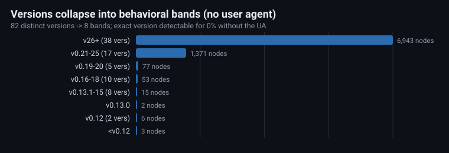
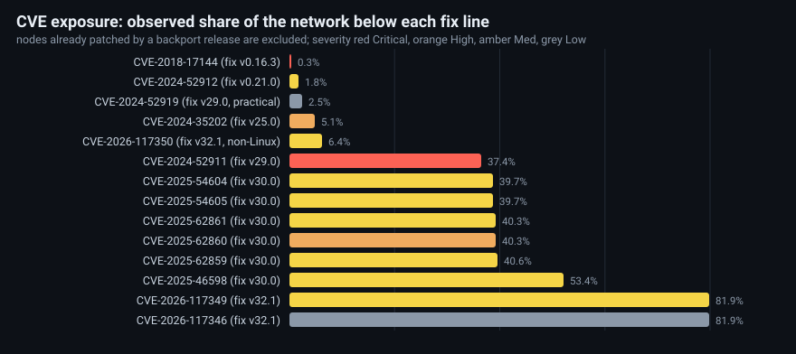
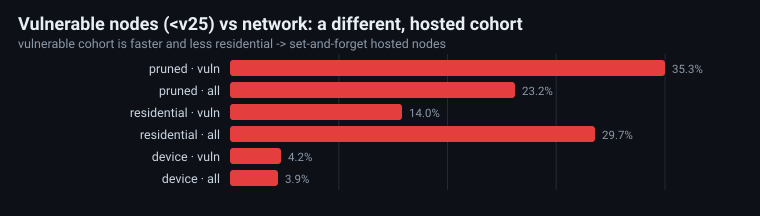
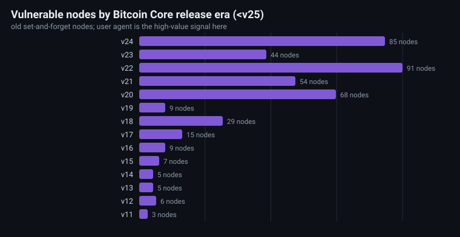

### Vulnerability: Which nodes are exposed to known CVEs?

Mapping reachable-node versions to published remotely-triggerable advisories, and showing that
removing the user agent does not hide a vulnerable node from behavioural probing.

---

### Does hiding the user agent help? It cuts both ways

The user agent prints a node's exact version. We mapped each node's true version to the behavioural
band feature-probing can observe (the set of protocol features it speaks, shared across releases).
The 82 distinct full versions collapse into 8 bands. With the features we probe, only 5 nodes were
uniquely version-identifiable from behaviour, and the largest band (v26 and up) groups 38 versions
into one.

Hiding the user agent helps for some advisories and not others. For the old high-severity remote
crashes the exposed nodes are behaviourally ancient and stay identifiable without the user agent: a
node without `wtxidrelay`/`sendaddrv2` is pre-0.21, without segwit older still. But some recent
advisories expose nodes inside the v26+ band, which feature-probing cannot split, so there the user
agent is the only thing that reveals the exact version, and removing it does conceal the exposed set
(the "no" rows below). The clearest case is CVE-2025-62860 (High, inbound-Tor whitelist bypass), fixed
at v30 with 40.3% exposed, all sitting inside the v26+ band.

### Exploitability: from fingerprint to CVE

We see each node's full version, so we compare it to the advisory's exact fix line and its backport
releases. The result is the observed exposed set, not a major-version upper bound that would count
backported sub-versions as still exposed.

"Exposed" is version exposure, not a claim of equal exploitability. The trigger differs per advisory:
some fire on a cheap unsolicited P2P message, others need a crafted or invalid block (miner- or
block-triggerable, a higher bar) or a specific platform. So the percentage is an upper bound on
practical risk for that advisory, and the "Backport / caveat" column flags the conditions we know of.

"Flaggable w/o UA" is whether behavioural probing alone, ignoring the self-reported user agent, can
tell a node is in the vulnerable version range. It is "yes" when the exposed nodes fall below a
behavioural boundary (pre-0.21 lacks `wtxidrelay`/`sendaddrv2`, older nodes lack segwit); "no" when
the fix sits inside the v26+ band, which feature-probing cannot split, so you would need the user
agent to know the version; "partial" for CVE-2024-35202, whose v25.0 fix falls inside the v0.21-25
band, so probing flags the band but cannot separate the exposed v21-24 nodes from patched v25. The
"no" rows are where removing the user agent would actually conceal the exposure.

| CVE | Type | Fixed in | Backport / caveat | Trigger | Exposed | Flaggable w/o UA |
|---|---|---|---|---|---|---|
| CVE-2018-17144 | inflation / assert DoS (Critical) | 0.16.3 | — | block | 0.3% | yes |
| CVE-2024-52912 | timestamp-overflow net-split (Med) | 0.21.0 | — | p2p msg | 1.8% | yes |
| CVE-2024-35202 | blocktxn assert crash (High) | 25.0 | — | p2p msg | 5.1% | partial |
| CVE-2024-52911 | script interpreter crash (Critical) | 29.0 | — | crafted block | 37.4% | no |
| CVE-2024-52919 | addrman 32-bit id overflow (Low) | 29.0 | rate-limited from 22 | p2p msg | 2.5% | no |
| CVE-2025-46598 | CPU DoS via unconfirmed txs (Med) | 30.0 | — | p2p msg | 53.4% | no |
| CVE-2025-54604 | disk fill via spoofed self-conn (Med) | 30.0 | bp 29.1 | p2p msg | 39.7% | no |
| CVE-2025-54605 | disk fill via invalid blocks (Med) | 30.0 | bp 29.1 | block | 39.7% | no |
| CVE-2025-62861 | TRUC eviction corrupts mempool (Med) | 30.0 | bp 28.3 / 29.2 | reorg | 40.3% | no |
| CVE-2025-62860 | Tor whitelist bypass (High) | 30.0 | bp 28.3 / 29.2 | p2p msg | 40.3% | no |
| CVE-2025-62859 | compact block witness stall (Med) | 30.0 | bp 29.2 | p2p msg | 40.6% | no |
| CVE-2026-117349 | OOM via paused peer queues (Med) | 32.1 | bp 29.5 / 30.4 / 31.2 | p2p msg | 81.9% | no |
| CVE-2026-117350 | OOM via TCP urgent data (Med) | 32.1 | bp 29.5 / 30.4 / 31.2, non-Linux | p2p msg | 6.4% | no |
| CVE-2026-117346 | undo file overflow crash (Low) | 32.1 | bp 29.5 / 30.4 / 31.2 | miner reorg | 81.9% | no |

Exposure is not the same as exploitability, which is why the Trigger column matters. The worst
advisories are the hardest to fire. CVE-2024-52911 (Critical) needs a crafted block. CVE-2026-117346
and CVE-2025-62861 need a miner to execute a reorg. CVE-2025-54605 and CVE-2018-17144 need blocks.
All of those take proof-of-work or at least block relay, far more than sending a message. The
advisories you can trigger with a cheap message are mostly Medium resource-exhaustion bugs. Only two
cheap ones are High: the old blocktxn crash (CVE-2024-35202, below v25) and the modern Tor whitelist
bypass (CVE-2025-62860, below v30, 40.3%).

On the exposure numbers: in the v30 batch only the CPU DoS (CVE-2025-46598) was never backported, so
it stays at 53.4%; the rest were backported to 28.3/29.1/29.2 and drop to about 40%. The v32.1 batch
is 81.9% after its 29.5/30.4/31.2 backports. The exception is the TCP-urgent OOM, which is non-Linux
only, so just 6.4% (counting only nodes we could confirm are non-Linux from our nmap `-O` scan plus
the monthly node-OS dataset, [ViniciusCestarii/bitcoin-node-os-fingerprint](https://github.com/ViniciusCestarii/bitcoin-node-os-fingerprint),
so a lower bound). One oddity: v32.0 was tagged but never released, so the first real v32 is 32.1 and
the few nodes claiming 32.0.0 are below the fix.

So does hiding the user agent help? It depends on the node's era. The dangerous cheap crashes are
old: the blocktxn crash (below v25) and the addrman overflow (CVE-2024-52919, below v22, 2.5% after
rate-limiting). Those nodes are old enough that probing spots them anyway, user agent or not. The one
cheap High bug that reaches modern nodes, the Tor whitelist bypass (below v30), sits inside the v26+
band where probing goes blind. There the user agent is the only tell, so hiding it would help the
node. The `test_cve_*.py` files model the vulnerable-versus-fixed behaviour of each advisory,
mirroring the regression tests in the fix PRs.

### The vulnerable cohort is a different population

Vulnerable nodes and weak nodes are not the same machines. The 430 nodes below v25 (exposed to the
unpatched remote-crash advisories) are better-resourced: 28 Mbps median vs the overall median, less
residential, no more embedded. They are disproportionately pruned, fitting hosted nodes configured
once and never upgraded.

On the two axes: vulnerability overlaps the disk axis but avoids the bandwidth axis. The targets
that are vulnerable AND constrained on either axis number 168. The crash-a-vulnerable-node set is
ranked by the user agent and lives on hosting, the one cohort where the user agent adds information
(behavioural probing only bounds it to pre-v26). The bandwidth-exhaustion set is ranked by network
class and latency. The metadata that identifies one set does not identify the other.

---

[Back to main report](../REPORT.md)
